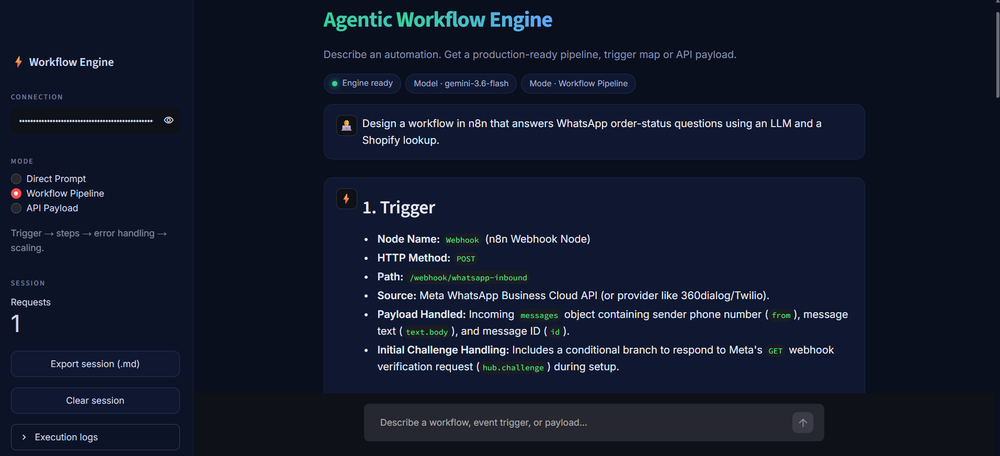
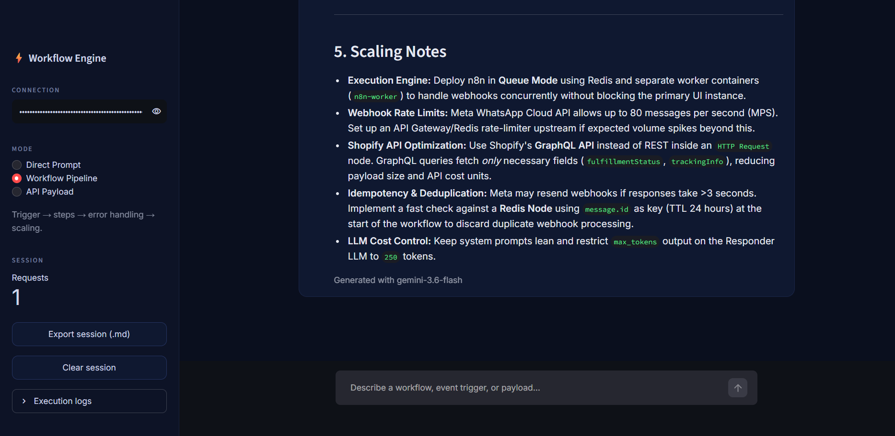

# Agentic Workflow Engine


Describe an automation in plain English and get back a workflow plan, a list of triggers, or a ready-to-use API payload.

I built this to get hands-on with LLM APIs and workflow tools like n8n, Make and Zapier. The examples lean towards eCommerce customer support: order status, ticket triage, refunds.




## Try it

Run it locally, paste a Gemini API key in the sidebar, and click one of these starters:

| Starter | What you get |
|---|---|
| Order-status bot | A workflow for answering "where is my order?" on WhatsApp |
| Ticket triage | A pipeline that scores support tickets and escalates urgent ones |
| Refund payload | A webhook JSON payload for a refund event |

Or type your own, for example:

> What is the difference between n8n, Make and Zapier, and which one suits customer support automation?

## Modes

| Mode | Best for | Output |
|---|---|---|
| Direct Prompt | Quick questions | Normal answer |
| Workflow Pipeline | Designing an automation | Trigger, steps, data mapping, error handling, scaling |
| API Payload | Webhook testing | JSON only |

## Run it

```bash
pip install -r requirements.txt
streamlit run main.py
```

Get a free Gemini API key at https://aistudio.google.com/apikey and paste it into the sidebar.
The key stays in your browser session only. It is not saved and not in the code.

<details>
<summary>Why does it pick the model automatically?</summary>

My first version hard-coded `gemini-pro` and kept failing with a 404, because Google retires old models and the names stop working.

Now the app asks the API which models your key can use, picks the best one, and falls back to the next one if a call fails. The model used is shown under every reply.
</details>

<details>
<summary>Project layout</summary>

```
main.py            the whole app (UI + Gemini calls)
requirements.txt   dependencies
README.md          this file
```
</details>

## Built with

Python, Streamlit, and the Gemini API (called with `requests`).

## Note

I used AI tools (Claude and Gemini) while building this, and I tested and ran the app myself.

## Next

- [ ] Send generated payloads to a real n8n or Make webhook
- [ ] Add a small knowledge base so answers come from real FAQ data
- [ ] Write tests for the model fallback